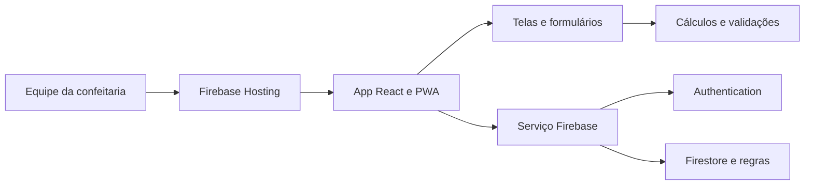

# Arquitetura

## Visão implementada

Aplicação web estática com estado React e acesso direto ao Firebase pelo SDK web. Não há API HTTP própria, servidor Node de produção ou Cloud Functions neste repositório. O navegador recebe os assets de `dist/` pelo Firebase Hosting.

## Componentes e contratos

| Arquivo           | Responsabilidade                                                                                                             |
| ----------------- | ---------------------------------------------------------------------------------------------------------------------------- |
| `src/main.tsx`    | Monta React em StrictMode e carrega o CSS                                                                                    |
| `src/App.tsx`     | Sessão, perfil, menu, hash, filtro de período, contexto, gravações, arquivamento, exportação e instalação/atualização da PWA |
| `src/context.ts`  | Contrato `Business` compartilhado com telas e formulários                                                                    |
| `src/pages.tsx`   | Componentes de painel, vendas, encomendas, financeiro, cadastros, cobranças e relatórios                                     |
| `src/editors.tsx` | Formulários, cálculos de composição e conversão para mutations                                                               |
| `src/ui.tsx`      | Campos rotulados, modal nativo, tabelas, paginação e download                                                                |
| `src/domain.ts`   | Funções de datas, dinheiro, custos, recebíveis, validação e serialização                                                     |
| `src/types.ts`    | Coleções e contratos compatíveis com dados legados                                                                           |
| `src/firebase.ts` | SDK Firebase, sessão, listeners, transações, backup e erros                                                                  |
| `src/demo.ts`     | Fixtures exclusivas da demonstração de desenvolvimento                                                                       |

`pages.tsx` e `editors.tsx` ainda concentram múltiplos módulos. São a organização atual, não uma obrigação arquitetural de mantê-los grandes. Uma divisão futura precisa preservar os contratos e ter escopo próprio.

## Sessão e leitura

`onAuthStateChanged` identifica a conta. `profileFor` consulta `usuarios/{uid}` no servidor e exige papel `admin` ou `viewer` antes de iniciar as assinaturas. O estado é limpo quando muda a sessão; geração/cleanup dos listeners impedem uma resposta antiga de repor dados de outra sessão.

`subscribeData` acompanha as 12 coleções conhecidas. Atividades são limitadas às 40 mais recentes, por `criadoEm`; a exportação completa consulta todos os documentos dessa coleção. As demais coleções são carregadas sem paginação no servidor. A paginação das tabelas é local, com dez linhas por página.

As regras executáveis estão em [firestore.rules](../firestore.rules). A interface ajuda a restringir ações, mas a autorização efetiva é feita no Firestore. O perfil de consulta não grava; uma conta sem perfil não consulta os dados comerciais.

## Gravação e concorrência

1. O formulário valida datas, campos e cálculos de domínio.
2. O formulário de edição guarda a versão do registro aberto (`expectedUpdatedAt`).
3. `App.save` evita submissões simultâneas e oferece implementação em memória para a demonstração.
4. `mutate` exige administrador, sessão atual e conexão, e reconfirma o perfil no servidor.
5. Uma transação lê os registros existentes, compara as versões e aplica alterações e uma atividade no mesmo commit.
6. Um conflito é informado ao usuário; não se confirma sucesso antes do commit. Os listeners atualizam as telas.

Há limite local de 400 mutations por operação. Transações não são enfileiradas offline. Cadastros de clientes, produtos, ingredientes, receitas e materiais são arquivados; as regras impedem sua exclusão física pelo cliente web.

## Navegação, ambiente e publicação

A navegação usa `location.hash` (`dashboard`, `vendas`, `encomendas`, `financeiro`, `cadastros`, `cobrancas`, `relatorios`). A SPA também atende o antigo `/login.html` graças ao fallback do Hosting.

`VITE_USE_EMULATORS=1` só tem efeito em desenvolvimento, nos hosts locais permitidos. A flag conecta Authentication em 9099 e Firestore em 8080 usando `demo-doceria`. `?demo=1`, `?demo=viewer` e `?demo=login` também só são interpretados em desenvolvimento. Não há segredo de servidor necessário no bundle.

O workflow de [CI](../.github/workflows/deploy.yml) instala pelo lockfile, verifica tipos/domínio/build/auditoria e executa testes de navegador, PWA, regras e integração. PRs validam; push em `main` também publica Hosting e regras. Índices e faturamento não são alterados pelo comando de publicação atual.

## PWA e disponibilidade

`vite-plugin-pwa` gera manifesto e service worker. O usuário recebe aviso de atualização e confirma quando aplicá-la; a atualização fica indisponível enquanto há uma gravação em andamento. Favicon, Apple touch icon e manifesto usam o PNG original de 1024×1024 em `public/images/logo.png`, sem recorte ou recoloração. O arquivo também entra no precache estático. O teste PWA compara seus bytes e hash histórico e consulta os erros de instalação do Chromium.

## Layout e identidade

`src/BrandLogo.tsx` concentra a referência à imagem original; login, carregamento, menu e cabeçalho a exibem com `object-fit: contain`. A barra lateral tem altura de viewport dinâmica e rolagem própria, incluindo marca, navegação e ações finais. Em até 900px, funciona como drawer com fechamento interno, Escape, foco contido e fundo inerte; a mudança para desktop libera o bloqueio de rolagem.

Tabelas possuem região focável e rolagem local. Diálogos nativos rolam integralmente e mantêm ações no fluxo do conteúdo; a página de fundo fica bloqueada enquanto estão abertos. A matriz de regressão está em `playwright.responsive.config.ts` e cobre alturas pequenas e os limites dos breakpoints, além de WebKit em celular e tablet.

O cache do service worker contém arquivos estáticos. Não há runtime cache de APIs, persistência Firestore em disco ou promessa de consulta após reabrir offline. Uma página já aberta pode conservar dados em memória, mas gravar continua exigindo conexão.

## Limitações verificáveis

- Listeners completos podem aumentar leituras conforme os dados crescem; paginação em memória não reduz leituras do servidor.
- A exportação lê coleções sequencialmente, sem snapshot global: gravações concorrentes podem aparecer em instantes distintos no arquivo.
- Regras validam campos principais, não cada estrutura aninhada ou todas as invariantes de negócio. O SDK administrativo não é limitado por essas regras.
- Custos históricos de vendas novas têm snapshot. Para vendas legadas sem `custoUnitario`, a estimativa usa o cadastro atual do produto.

Evidências: [domínio](../src/domain.ts), [serviço](../src/firebase.ts), [App](../src/App.tsx), [tipos](../src/types.ts), [Vite](../vite.config.ts) e [testes](../tests/).
